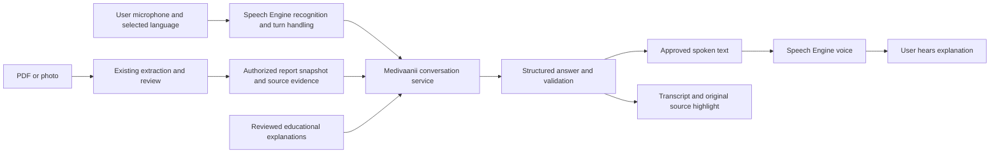

# Medivaanii multilingual voice agent — research and proposed plan

14 October 2026. Research proposal; no voice agent has been built or deployed in this task. Provider documentation and current application code were inspected. No paid voice benchmark was run and no private report was sent to a new provider.

Budget update: the user subsequently requested a free solution and free deployment options. The cost/provider recommendation below is superseded by the [free voice and hosting proposal](2026-10-14-free-voice-and-hosting.md). The report context, source validation and patient-understanding requirements still apply. Paid providers below remain comparison candidates, not the current default.

**Recommendation**

Pilot an in-app conversation using ElevenLabs Speech Engine and a Medivaanii report-answering service. Keep report retrieval, conversation memory, and answer validation on our server. Use `gpt-6.1-sol` at low reasoning effort as the initial answer-generation candidate, with source-backed facts and reviewed educational content. Audition `eleven_v4_turbo` for speech and Scribe realtime recognition. Confirm the exact Speech Engine ASR configuration, v4 Turbo availability, voice choices, and billing in the account during the first implementation spike. These are candidates selected from documentation, not demonstrated winners on rural speech.

The user selected four languages for the first pilot: English, Hindi, Spanish, and Mandarin. A fifth language is outside this pilot. The user clarified that the purpose is to help rural people understand what their uploaded report says through an easy conversation, especially when their consultation has not explained the report clearly. An in-app conversation remains the working channel assumption; the clarification did not request ordinary telephone calls.

The core experience is a patient choosing a language, starting a conversation about the uploaded report, and asking follow-up questions in their own words. The agent should explain one concept at a time, remember the topic within the session, accept interruptions, repeat or simplify an explanation, and connect the spoken explanation to the original evidence. Measure whether the person can describe the report's key information and remaining uncertainties in their own words after the conversation. This is an understanding goal; listening to a long summary is insufficient.

Speech Engine is a fit because it manages speech, turns, interruptions, and browser playback while allowing our own backend workflow. It can integrate with the existing Python Starlette application. This avoids replacing the frontend or moving patient reports into a shared hosted knowledge base. These are architectural judgments based on the [Speech Engine documentation](https://elevenlabs.io/docs/overview/capabilities/speech-engine).

**What the application actually has**

| Capability | Current implementation | What can be reused |
| --- | --- | --- |
| PDF/photo extraction | Per-page pdfplumber/Tesseract, coordinate/header extraction, optional isolated Docling worker, reconciliation and validation | Original source fields, physical page/cell boxes, stable measurement identities, quality states |
| Report review | Original PDF beside grouped/searchable results; corrections retain provenance | Voice answers can select the same result and highlight the same source |
| Narration | Flutter posts prepared text to `/synthesize`, receives a complete MP3 chunk, then plays it; pause/resume/stop exist | Playback controls and visual language, but the transport needs replacement for conversation |
| Speech providers | Actual order: Edge TTS → Sarvam Bulbul v3 → ElevenLabs Multilingual v2 → gTTS | Provider adapters can remain for ordinary read-aloud; their presence does not establish working paid credentials |
| Typed questions | `/report/question` performs bounded English intent/alias lookup against eligible measurements and reported notes | Eligibility logic, evidence lookup and test cases; a new multilingual conversational layer is needed |
| Translation | Claude Haiku 4.5 when configured, then an unofficial Google Translate endpoint, then original text | Existing display workflow; unsuitable as an invisible failure path for spoken conversation |
| Language UI | English plus eight Indian languages | Language picker; Spanish and Mandarin must be added explicitly |
| Education | Small English educational library and neutral organ illustrations | Review and localize these concepts before the voice agent explains them |
| Context storage | Last report/original in browser IndexedDB; SQLite history when patient ID is provided; jobs held in memory | Prototype storage only; it is not authenticated, durable report/session ownership |
| Voice conversation | No microphone/ASR flow, realtime session, conversational memory, interruption-aware answer loop, or voice evaluation suite found | New work |

Code evidence: `flutter_app/lib/main.dart:95,487,901,998`; `backend/main.py:298,624`; `backend/report_review.py:230`; `backend/agents.py:15,76,121`; `backend/elevenlabs_tts.py:19`; `backend/sarvam_tts.py:28`; `backend/db.py:16`. Existing benchmark scope is documented in `docs/reliable-extraction-evaluation.md`.

Two immediate defects matter for this feature: `/synthesize` maps unknown languages to Hindi, and the existing ElevenLabs adapter supplies region codes while the current model documentation specifies language codes such as `en`, `hi`, `es`, and `zh`. Its globally cached voice selection also does not choose a reviewed native voice per language. The TTS function's docstring describes a different provider order from its executable code. We must make routing explicit and visible rather than silently substitute a language or provider.

The question endpoint currently receives a report object from the browser. Revalidating that object is useful for extraction consistency, but does not prove ownership or authenticity. A product voice session must fetch its report from trusted server storage and verify access; the browser should supply an authorized report ID, not the authoritative report content.

**Model and platform choices**

| Option | Proposed role | Advantages | Practical limitation |
| --- | --- | --- | --- |
| ElevenLabs Speech Engine | Preferred pilot voice layer | Own backend; managed turn detection, interruptions and WebRTC client integration; selectable voices | External service, publicly reachable authenticated callback needed even for local development; exact account/model configuration needs verification |
| `scribe_v2_realtime` / Speech Engine Scribe realtime ASR | Recognition candidate | Documented support for all four pilot languages; realtime keyterm prompting can bias report test names | Rural accents, mixed Hindi/English, noise and decimals still need measured testing; do not assume the batch Medical model is a realtime model |
| `eleven_v4_turbo` | Speech candidate | Current model family covers English, Hindi, Spanish and Mandarin; designed for realtime speech | Vendor inference latency is not end-to-end app latency; native-language voice auditions and numeral pronunciation tests are required |
| `gpt-6.1-sol`, Responses API, low effort | Initial report-answer candidate | Tool calling and structured output for source-linked answers | Must validate semantics and facts; structured JSON is not proof of a correct answer |
| `gpt-6-luna` | Cost/latency challenger for bounded explanation tasks | Cheaper text inference; same tool/schema workflow possible | Promote only after it meets the same multilingual fact and content thresholds |
| `gpt-live-1` with client delegation | Natural-conversation challenger | Full-duplex conversation with an independently controlled backend | Its spoken rendering is another model stage; correct backend text does not guarantee identical spoken facts. Test emitted audio and control playback |
| `gemini-3.8-live` | Lower-cost native-audio challenger | Current stable Live model; function calls and broad language support | Native audio lacks structured outputs; proactive audio and spoken paraphrases need stronger evaluation/control before patient-facing use |
| Sarvam Saaras v4 + Bulbul v4 Flash | Optional India-focused challenger | Indian-language speech and code-mixed voices | Does not cover Spanish/Mandarin as the complete global stack; adds transport/provider routing work |

The [ElevenLabs model catalogue](https://elevenlabs.io/docs/overview/models) lists `eleven_v4_turbo` and its language coverage. The [transcription documentation](https://elevenlabs.io/docs/overview/capabilities/speech-to-text) lists English/Hindi/Spanish/Mandarin recognition and realtime keyterm limits. The [5 October changelog](https://elevenlabs.io/docs/changelog/2026/10/5) adds v4 agent voice options. Some older language configuration pages still describe Flash defaults and 31 languages, so current SDK/schema/account behavior must take priority over old examples.

OpenAI's current [GPT-6.1 Sol](https://developers.openai.com/api/docs/models/gpt-6.1-sol) and [GPT-6 Luna](https://developers.openai.com/api/docs/models/gpt-6-luna) pages support the text-model roles above. Its [voice architecture guide](https://developers.openai.com/api/docs/guides/voice-agents) distinguishes native voice, backend delegation, and a controllable speech/text pipeline. [GPT-Live client delegation](https://developers.openai.com/api/docs/guides/live-delegation) lets our server review results before returning them to the voice model.

Google recommends [Gemini 3.8 Live](https://ai.google.dev/gemini-api/docs/models/gemini-3.8-live) for its current low-latency Live path; 3.1 Flash Live is a legacy preview. The [Live capabilities guide](https://ai.google.dev/gemini-api/docs/live-api/capabilities) documents language coverage. [Sarvam's Bulbul page](https://docs.sarvam.ai/api/getting-started/models/bulbul) identifies v4 Flash as its newer model and specifies its Indian-language scope. These alternatives belong in a controlled comparison, not a chain of several providers invoked for every answer.

**Proposed data flow**

The agent has access to the complete authorized report, rather than only the summary card. At session start it receives a compact inventory: report family, dates, available sections, extraction coverage, eligible measurements, missing regions, language, and revision. It retrieves relevant source records as the conversation progresses. This keeps context complete without repeatedly sending all 33 pages or treating equipment dashboards/guidelines as patient results.

For a question about one result, the backend resolves its measurement ID, checks the current revision/eligibility, obtains its exact value/unit/reference/printed flag and source cells, and adds a reviewed explanation of what that test measures. The model produces a brief response in the selected language. Before speech, the application verifies record IDs, values, units, range statements, corrected-versus-original attribution, coverage claims and allowed educational concepts. Failed checks produce a clarification or an explicit limitation. Every report-specific claim should carry evidence; general educational claims should carry an approved content ID.

Fact-containing text must be checked before it is released to audio. Initially validate an entire short answer; later stream individually validated blocks if latency warrants it. Streaming raw model tokens directly into TTS would allow an incorrect value to be heard before validation. This design reduces specific failure modes; it is not a guarantee against every medical or linguistic error.

Illustrative response contract: `session_id`, `report_revision`, `language`, `answer_status`, `display_blocks`, `spoken_text`, `report_claims[{measurement_id, field, source_value}]`, `education_ids`, `source_ids`, `clarification`. Numeric facts should be rendered from canonical source fields using reviewed language-specific pronunciation rules. Do not let a second unrestricted translation rewrite them. An unclear spoken number should trigger a question, not silently replace the printed value.

Read-only internal functions could include `get_report_inventory`, `find_report_items`, `get_source_fields`, and `get_reviewed_explanation`. The server derives the report identity from the authenticated session. The model cannot request another patient's report, edit measurements, prescribe a medicine, or change a dose. Report text and speech are untrusted data, not system instructions.

Use session memory for the selected result, previous questions, language and pace. Keep it isolated per person/report/revision. When the report is corrected or switched, interrupt pending speech, invalidate stale work and reload context. On a reconnection, identify what was actually played; do not tell the user they already heard unfinished speech.

**Language and report scope**

Use one explicit registry with provider adapters: English `en-IN` → TTS `en`; Hindi `hi-IN` → `hi`; Spanish `es-419` provisionally → `es`; Mandarin `zh-CN` → `zh`. Recognition uses each provider's documented codes, which need not equal TTS codes. Mandarin is a spoken language choice; simplified/traditional transcript script is a separate preference. Permit a user to request a language change, then deliberately update or restart the voice configuration if needed. Never substitute Hindi for unsupported Spanish/Chinese.

Test the whole chain in each language: microphone recognition, code-switching, correct test matching, translated explanations, number/unit speech, native pronunciation, transcript fonts and interaction text. Four language buttons alone do not demonstrate four-language support. Clinically reviewed language examples and native listeners matter more than vendor language counts.

The requirement “any report” is the product direction, not the current capability. The existing 95/95 benchmark applies to one reviewed lab PDF and the anonymous fixtures, not universal report extraction. Build report-family support with visible coverage:

| Family | Voice behavior to build | Needed validation |
| --- | --- | --- |
| Laboratory | Explain sourced results and supplied references; compare only compatible values/dates | Broader provider corpus, qualitative tests, old/current results and missing references |
| Radiology/pathology narrative | Explain what the report's findings/impression says, with exact attribution | Section extraction, negation, uncertainty and relevant source paragraphs |
| Prescription | Read confirmed medicine, strength, route, frequency and duration; request review when unreadable | Medication-specific field extraction and pharmacist/clinical content review; handwriting is not supported now |
| Discharge summary | Explain reported diagnoses, procedures, follow-up and instructions | Section and date/identity mapping, source-backed instructions |
| Poor scans/photos or unfamiliar layouts | Explain what is readable and help the user review/retake; acknowledge missing coverage | Printed multilingual OCR and photo corpus; multiple photos and handwriting are additional work |

A voice agent cannot repair a missing extraction field simply by sounding confident. Unreadable report content remains unreadable until extraction/source review resolves it. It should still help a user navigate the report and explain why review is needed.

**Premium experience for rural users**

Keep Medivaanii's name/logo, Noto typography, burgundy, ivory and sage. Add a prominent “Talk about my report” action beside the existing reading workspace. A focused panel shows the selected report, native language label, a restrained animated voice indicator, clear Listening/Checking your report/Speaking states, and a large microphone control. Allow interruption, mute, end conversation, repeat, slower and simpler explanations. Start audio only after an explicit tap. Avoid emoji and distracting continuous animation; honor reduced motion.

Use short, calm answers and one follow-up at a time. Start by asking whether the user wants an overview or has a question. Let the person use their own vocabulary. When discussing a result, show the original source card and page highlight; tap it to open the explorer. Show translated captions as an option, with the original test label alongside the translated name. Keep the existing neutral organ illustration when a reviewed concept has one. Choose voices by native pronunciation and patient comprehension; the existing random/global voice picker is insufficient.

Build a low-bandwidth push-to-talk alternative, visible reconnection state, replay of the last completed answer and a text fallback. Test low-cost Android devices, Chrome/Safari microphone permissions, speaker echo, environmental noise, intermittent connectivity and slow uploads. WebRTC does not create offline understanding: recognition and reasoning still require a connection. Ordinary phone access is a later channel requiring report linking, identity checks, a telephony provider and separate cost testing.

**Privacy and deployment dependencies**

Add authenticated server-owned reports and short-lived voice-session credentials before a public pilot. Use a local authorized session boundary for local evaluation. The browser receives a session token, never vendor keys. Bind provider connections to authorized report sessions on the server, verify Speech Engine callback signatures and expire session mappings. A public callback/tunnel is required for Speech Engine development; expose only the necessary authenticated routes, not the entire unprotected localhost app. See the [official quickstart](https://elevenlabs.io/docs/eleven-api/guides/cookbooks/speech-engine).

Voice audio is processed by the speech vendor; a selected, minimized report context and conversation text reach the answer-model provider. Explain this before starting a real session. Disable recording by default, specify transcript/history retention and deletion, and keep raw private content out of application logs. Disabling audio recording is not the same as zero transcript retention. Vendor zero-retention eligibility and Speech Engine coverage require explicit account/contract verification; [ElevenLabs' retention documentation](https://elevenlabs.io/docs/eleven-agents/customization/privacy/zrm) describes a separate feature. No compliant medical-data deployment or zero retention is established by this research.

**Costs and evaluation**

The published [ElevenAPI pricing](https://elevenlabs.io/pricing/api) lists Speech Engine at $0.08/minute, with $0.16/minute burst pricing. A five-minute session therefore has a $0.40 standard speech component. Backend model usage is separate. At the published Sol standard rates, an assumed total of 30,000 uncached input tokens and 2,000 billed output tokens adds $0.08: approximately $0.48 variable cost in this illustrative session. This excludes subscriptions/minimum spend, extra reasoning/output beyond the assumption, infrastructure, taxes, telephony, and any model-specific surcharge. Do not add separate Scribe/TTS API charges again if they are included in the Speech Engine billing contract.

[GPT-Live 1](https://developers.openai.com/api/docs/models/gpt-live-1) lists $0.05/minute plus backend usage: $0.25 for five minutes before its backend costs. Google's [current Live pricing](https://ai.google.dev/gemini-api/docs/pricing) lists approximately $0.005/minute input audio and $0.018/minute output audio. An illustrative two minutes input plus three minutes output is $0.064 for audio, before text/context and other charges. These billing bases differ, so compare actual complete-session usage rather than headline rates. No currency conversion or real measured cost is claimed here.

Run a controlled pilot comparison: preferred Speech Engine stack versus GPT-Live and Gemini Live on the same anonymized scenarios, report revision, languages and device/network conditions. First prove source correctness; then compare comprehension, pronunciation, conversational timing, interrupted replies, completion rate and cost. Do not run three stacks per user conversation. Sarvam is an optional focused Hindi comparison if native pronunciation or India costs justify more work.

Suggested pilot evaluation set: at least 20 scenarios per language, plus multi-turn sessions with several native speakers per language. Include decimals, negative statements, micro units, similar test names, missing results, partial reports, mixed-language speech, report corrections, interruptions and another patient's record requests. Add native clinical/content reviewers for explanations. Initial gates: no wrong patient/report, no fabricated or altered critical facts in the reviewed corpus, correct handling of every blocked/partial test case, traceable report claims, acceptable native-listener comprehension and reliable interruption/reconnection behavior. A zero-error pilot score is not a claim of universal accuracy.

Set proposed latency targets of first audible response within two seconds at the median and four seconds at the 95th percentile on a defined good-network test profile. Measure substantive answer latency separately from a brief acknowledgement. Report rural-network results separately. Provider 100/150 ms inference claims exclude our backend, validation, transport and network, and do not establish these targets.

**Implementation sequence after design decisions**

1. Establish the context foundation: server-owned report snapshots, session authorization, revision invalidation, explicit language/provider codes, localized reviewed concepts and an evidence-bearing answer contract. Reuse current source/quality validators. Demonstrate typed questions in all target languages before adding audio.
2. Build a synthetic-data voice spike: verify Speech Engine account/model compatibility, token issuance, authenticated callback, microphone capture, native voices, interruptions and a complete fact-checked answer. Audit real emitted speech and compare the two native-audio challengers. Select one stack using the evaluation results.
3. Build the premium report panel: Flutter controls with a small JavaScript SDK bridge, captions, source highlighting, reduced motion, large mobile controls, clear errors and push-to-talk fallback. Keep typed/read-aloud flows available.
4. Validate and pilot: multiple report providers/families, native speakers, rural devices/networks, retention/deletion, rate limits and per-session spend caps. Expand report families according to measured extraction coverage. Add telephone/WhatsApp access only after in-app outcomes and report identity linking are reliable.

Confirmed scope: four pilot languages and conversational understanding of the uploaded report for rural users. Decisions still open: monthly budget/concurrent sessions, native voice preferences, and the first report families beyond labs. In-app voice is the working channel assumption; telephone access has not been requested. Current provider credentials, contracted retention settings, account access and real speech performance have not been verified. The immediate recommended next work is the server context/answer contract and a synthetic multilingual voice spike, before presenting the feature as working for every report.
