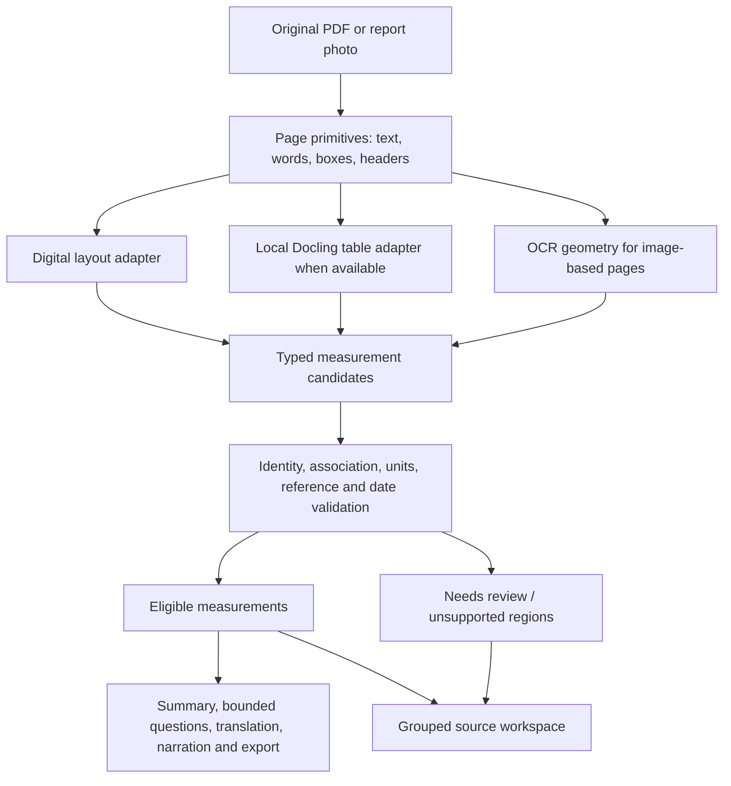

# Reliable report extraction and source workspace

Status: proposed design for review. No app implementation is claimed by this document.

## Intended outcome

Medivaanii should let a person upload a PDF or printed report photo, inspect their actual measurements beside the original, and understand eligible results through explanations and bounded questions. A source highlight must identify the measurement fields, not merely an occurrence of a number. Extraction review must not turn unsupported rows into trusted measurements.

The user has requested professional presentation, PDF/photo/camera intake, source-linked exploration, neutral body explanations, and fixes for incorrect extraction. Preserve the existing product name, exact logo, bundled Noto Sans, burgundy/ivory palette, Lucide icons, and restrained reduced-motion-aware transitions.

The first acceptance fixture is the privately held 33-page Healthians report. The reviewed inventory contains 95 primary measurement rows: 74 blood/chemistry/calculated measurements and 21 urine measurements. Its old extraction contains one matching patient measurement and 66 nonmeasurement rows. These counts describe this fixture; production must never hard-code 95 or use this inventory to extract results.

## Evidence and selected approach

The local Docling 2.138.0 trial reconstructs 85 correct name/value/unit associations with complete reference fields in tables. Ten measurements remain outside correct table rows, including single-test sections and a split Pus Cells row. A minimal clinical-header adapter accepts 55 correct rows with zero extras but misses 40; this is an adapter-specific result. Some raw name cells contain preceding method/machine text, and some tables have no embedded header.

The pdfplumber 0.11.9 header-aligned word prototype recovers all 95 core measurements but adds six guideline rows and truncates five multiline reference fields. One clean page-image trial using Docling/Tesseract recovers two of four complete measurements; its TSH unit changes from µIU/ml to wU/ml. Neither probe is a production-ready extractor.

Selected approach: preserve page geometry, use a fast digital-PDF path for supported layouts, and use local Docling as a table-structure/enrichment adapter. Both feed one typed measurement contract and validation policy. Coordinate-aware fallback handles single-test sections and missing table headers. Docling alone is unsuitable for the first milestone; another regex blacklist would not fix field associations.

Rejected alternatives: replacing the existing text parser with Docling Markdown would discard cell provenance; accepting every four-column table would include guideline targets; relying on user confirmation would leave source and unit errors unresolved.

## Scope and boundaries

In scope: extraction contract, supported digital layout parsing, optional local Docling adapter, printed-English OCR validation, per-field source evidence, output gates, bounded-question fixes, legacy cache handling, grouped report workspace, and regression/Chrome verification.

Out of scope: new clinical decision support, diagnoses from individual values, new external AI/OCR providers, patient accounts, authentication/ownership redesign, deployment, billing, general multi-report history, handwritten reports, and a claimed accuracy rate across providers. Existing translation/narration/export flows must respect the new gate; external-provider verification uses synthetic data unless the human explicitly authorizes a specific destination and private data.

## Architecture

Guidelines, metadata, historical columns, narrative, equipment descriptions, and advertising are classified separately. They do not enter laboratory result counts. Findings-only reports require independently source-supported narrative items; a keyword match alone cannot make their content eligible.

## Data contract, version 4

Each candidate includes these fields:

| Field | Contract |
|---|---|
| `measurement_id` | Stable opaque identifier derived from original-document digest, physical page, result block, and source row geometry; preserved through edits |
| `record_type` | `measurement`, `historical_measurement`, `guideline`, `metadata`, or `narrative` |
| `test_name` / `canonical_test` | Literal source name plus optional catalog identifier; unsupported names retain their original spelling |
| `panel` | Literal source panel heading, or `Other results`; grouping does not depend on an inferred disease |
| `value` / `value_kind` | Original text and `scalar`, `bounded`, `interval`, or `qualitative`; preserve `<`, `>`, decimals and qualitative words |
| `unit` / `normalized_unit` | Original unit and formatting-only normalization; preserve scales such as 10^3 versus 10^6 and dimension distinctions |
| `reference_range` / `reference_kind` | Full source field and `numeric`, `categorical`, `qualitative`, `contextual`, or `absent` |
| `sample_date` / `specimen` | Source-backed values, otherwise null; upload date is not collection date |
| `status` / `status_source` | Existing status enum; provenance distinguishes report flag, valid range comparison, user flag and unknown |
| `acceptance_state` | `eligible`, `needs_review`, or `rejected` |
| `issues` | Explicit issue codes and affected fields; no invented confidence percentage |
| `source_fields` | Immutable original name/value/unit/reference/flag text and boxes, with physical page, normalized top-left coordinates and native/OCR/Docling provenance |

An absent original unit or reference is an explicit absence, not a parsing error by itself. A unit that is present but unreadable, misassociated, or incompatible with a known test remains uncertain. A missing range can leave an eligible measurement's comparison status unknown. Preserve combined-cell locations where name/value/unit do not have separate boxes; do not invent smaller boxes.

Keep `parsed_data.lab_values`, `source_evidence`, and numeric `lab_id` as compatibility projections until Dart/JS consumers migrate. `lab_values` contains primary measurement candidates only, including visibly uncertain candidates; every downstream interpretation uses eligibility filtering. Rejected nonmeasurement records are kept in internal extraction diagnostics, not displayed as tests. Add stable identifiers to evidence and selection messages; never use display order as identity.

The serialized `parsed_data` also carries its version-4 schema marker, source digest, typed candidate evidence and quality metadata so the existing database can persist the contract without losing it. Top-level quality is a presentation projection of the same validation policy. History loaders reconstruct that contract rather than treating every nonempty saved row as eligible.

Top-level `extraction_version` becomes 4. `extraction_quality` contains:

- `state`: `ready`, `partial`, `blocked`, or `legacy_unverified`.
- `eligible_count`, `needs_review_count`, and `unresolved_result_regions`.
- `processed_pages`, `failed_pages`, and issue codes explaining partial coverage.
- `coverage_basis`: detected result sections/candidate rows for the supported layout, never an assumed fixture count or numerical confidence score.

`ready` means every detected candidate/region in a supported layout has been resolved with source-backed fields. It does not guarantee that arbitrary unseen layouts contain no undetected result. Unsupported provider layouts remain `partial` even when some rows are usable. No eligible measurements and no eligible narrative produce `blocked`.

## Extraction and classification

The page primitive reader preserves physical PDF pages, dimensions, words and boxes before concatenating text for compatibility. Invalid files and OCR failures raise typed extraction errors; error messages are never passed to report parsing as document text.

The first supported digital profile recognizes actual Healthians result headers and panel regions. It associates name/value/unit/reference by header columns and row geometry, including single-result panels. Method/machine labels are evidence about a row's structure, not patient measurements. PLR has a different label arrangement and must remain a genuine row. Source metadata supplies collection date/specimen; repeated 2024/2025 dashboard columns remain historical, separate from the current 2026 detailed section.

Multiline reference collection remains in the reference column and stops at the next measurement or a section boundary. Pregnancy, adult/pediatric interpretation tables, lipid target groups, equipment counts, identifiers and advertising must not become measurements. Qualitative urine values, interval values such as 1–2, and /HPF units are supported.

Other layouts use a conservative generic adapter only when actual clinical column semantics and field geometry can be established. Unknown/ambiguous structures remain partial; neither a test-name catalog nor a literal source quote independently establishes a patient result.

Docling runs locally, with remote services and external plugins disabled. The tested version is 2.138.0 in an optional isolated Python 3.12 worker environment; do not reuse the older global installation or add its large ML dependency graph to the API environment. Accurate tables/cell matching are the initial validated configuration. Pin this version for reproducible evaluation and retain the fast path when the worker is absent.

Prefetch public models during setup, never rely on downloading them during a report job. Use one warm Docling worker at a time on the current 8 GB machine, CPU with four threads, a 600-second hard worker deadline, and explicit partial/error handling. Image/full-page OCR uses the already installed local Tesseract engine. Cached model execution uses offline flags. A worker result is structured JSON; no private report content is printed to logs.

Reconcile engine output through source-field overlap and compatible field values/units. Conflicting values or units are quarantined; do not choose the more confident engine or match only an occurrence of a number. The digital adapter must preserve complete references even without Docling on supported layouts. Docling enrichment is accepted only when it agrees on the corresponding measurement identity and source geometry.

## Validation and output policy

Validation separates measurement identity from reference comparison. Eligible rows need source-backed identity, correct field association, a readable value, coherent unit semantics, and consistent current-date/specimen assignment when that context is present. Missing contextual information remains explicit. A catalog may flag an incompatible unit; it may not manufacture a missing value, unit, range or diagnosis.

Numeric comparisons require an unambiguous applicable reference and compatible units. Bounded and interval values are not treated as ordinary scalar floats. Categorical references retain every category and its inequalities; ambiguous category semantics leave comparison unknown. Pregnancy/pediatric/risk-group references must not be applied without appropriate context. A contradictory report flag and range comparison retains the original flag and raises an issue; no fabricated direction is inferred.

All interpretation paths read the same eligible rows. For `partial`, explanations/questions may discuss eligible measurements with a visible partial-coverage notice. They must not conclude that the whole report is normal. For `blocked` or `legacy_unverified`, suppress result summaries, result-based answers, translated result content, report narration and clinical summary export; retain the original and correction/re-upload controls. A generic explanation of extraction failure is allowed.

Confirmation acknowledges review; it does not modify eligibility. A corrected field records user provenance, preserves immutable source fields, and is revalidated. Invalid or unsupported corrections remain uncertain. Confirmed legacy edits are preserved as a separate overlay during source re-extraction; they are not overwritten automatically. A source-digest mismatch must refuse migration onto another document.

The current API receives full report objects from the browser. Within this prototype, recompute eligibility from source-backed candidate data and reject invalid state rather than trusting a client `eligible` flag. This is a reliability gate, not a claim of authenticated or tamper-proof server ownership; that remains separate production work.

## Bounded questions

Resolve intent before looking up tests. `higher`, `high`, `above range` asks for eligible rows whose comparison/flag establishes `high`; the word `High` inside a guideline label is not a test. `lower` selects `low`; `flagged` or `abnormal` selects actual nonnormal flags. Unknown comparison rows are separate and are not silently included as abnormal.

Use whole-token/canonical alias matching for named tests, with explicit ambiguity handling. Every supported answer carries stable measurement identifiers, physical source page and original field evidence. A missing test or unresolved result returns an unsupported answer without guessing. Existing diagnosis/treatment limits and neutral educational illustrations remain.

## Source workspace

Keep the original document beside a grouped, searchable test list and focused inspector on desktop. Replace the unbounded chip cloud with bounded groups: blood count, kidney, liver, lipids, thyroid, iron/vitamins, urine and other results, using source headings/canonical mappings. Display eligible and needs-review counts separately.

Selecting a row or PDF hit area sets one stable measurement ID, navigates to its physical page and highlights source name/value/unit/reference boxes. Reviewed values are displayed separately from immutable original values. Unmatched/ambiguous source hits show literal source text and an explicit limitation, not a guessed measurement. Add touch/keyboard alternatives, source zoom, meaningful focus order and readable provenance labels. On compact widths, show the selected result before the source with a back-to-source control.

Preserve the neutral body illustration library; only an eligible canonical measurement can bind to its educational explanation. A guideline row must never produce a kidney/blood/thyroid explanation. Keep clinical source characters unchanged while removing decorative emoji from generated presentation.

## Migration and persistence

Existing version-3 or unversioned browser records become `legacy_unverified`. Hide their cached interpretations immediately. Source-byte availability permits a deliberate version-4 re-extraction; saved text alone cannot recover original layout. If original bytes are unavailable, prompt for the original again. Confirmed corrections survive as labelled edits; source-digest mismatch and migration failure leave the old draft available without restoring confident outputs.

A legacy correction is applied to a newly extracted row only when its source identity maps uniquely. Ambiguous edits remain visible as unapplied corrections for the user to resolve; never map edits by the old list index. An unchanged or invalid field cannot acquire eligibility merely because the report was confirmed. Valid explicit field corrections retain user provenance and are evaluated separately from their immutable original OCR/source text.

Persist version-4 quality/evidence alongside the existing current-report IndexedDB record. Database/history reads that still contain old extractions must not bypass the gate. Do not extend data retention or make original files publicly accessible. Original-upload cleanup runs after success, timeout and failure.

## Acceptance and release checks

1. Private real-report benchmark: exactly 95 unique primary measurements, zero guideline/metadata rows, all raw values/units and full references matching the reviewed source, physical source pages/boxes present, and correct collection-date context. Expected data is used only by the evaluator. No private PDF, identifying text, screenshot, or benchmark inventory enters Git.
2. Regressions: separate sample dates, dashboard history, adjacent guideline tables, multiline categories, methods/machines, qualitative urine, interval values, missing references, OCR unit confusion, engine disagreement, failed pages, and user corrections.
3. Gates: legacy/blocked reports cannot produce result interpretations; partial coverage is explicit; review confirmation cannot bypass unresolved issues; translation/narration/PDF/history use the same policy.
4. Question: `Which values are higher?` returns eligible high measurements with source evidence and never risk-group targets. Missing/uncertain results are not invented.
5. Workspace: selecting creatinine/TSH/vitamin D navigates to physical pages 17/21/22 and highlights their actual fields; search/filter/grouping preserves stable selections. No invented highlight for changed source values. Narrow-width and keyboard checks pass.
6. Additional anonymous/synthetic digital provider layouts and raster scans are checked before release. Actual phone camera, narration, live external translation and PDF export receive their own recorded pass/fail evidence; untested paths stay labelled unverified.

The first milestone is the benchmark and gate, followed by source-workspace integration. Passing this fixture is not a clinical accuracy claim or a production launch.

## Inputs and references

- Local audit: `/Users/anant/Downloads/Medivaanii-Report-Audit-2026-10-13/AUDIT.md`.
- Local Docling trial: `/Users/anant/Downloads/Medivaanii-Docling-Trial-2026-10-14/RESULTS.md`.
- Private evaluator input: `/Users/anant/Downloads/Medivaanii-Report-Audit-2026-10-13/data/patient-measurements.json`.
- [pdfplumber coordinate and table APIs](https://github.com/jsvine/pdfplumber).
- [Docling local models, table options and offline operation](https://docling-project.github.io/docling/usage/advanced_options/).
- [Docling document representation](https://docling-project.github.io/docling/concepts/docling_document/).
